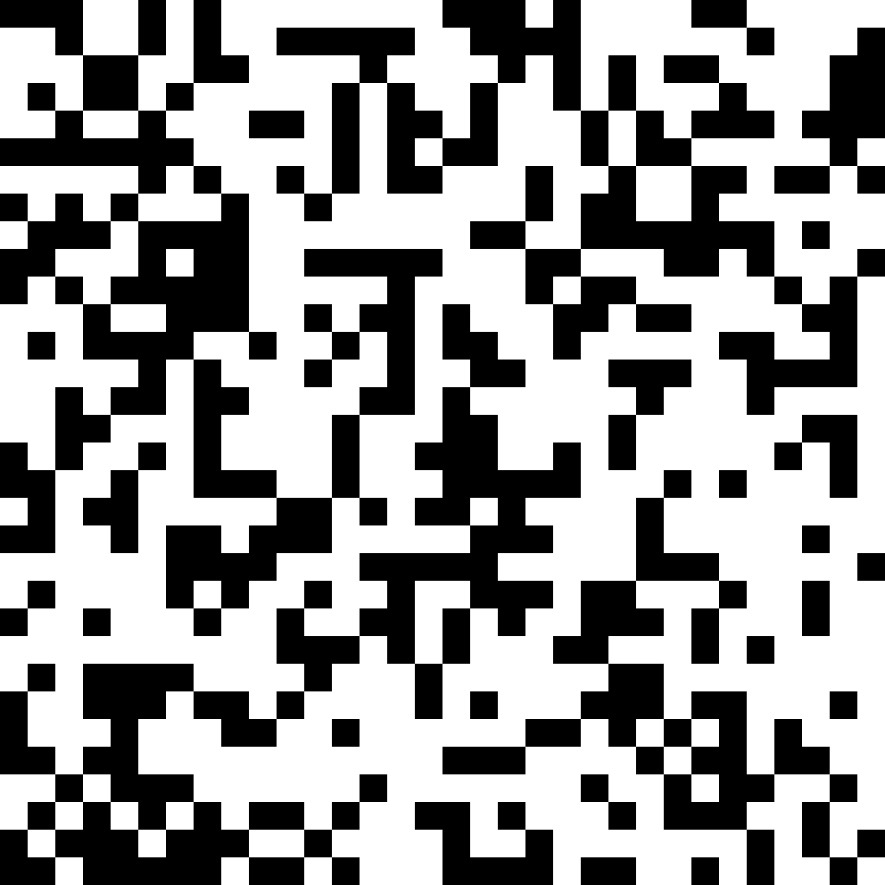

# Multilacunarity-ImageJ-Fiji-Plugin
Multilacunarity Computations for Binary Images (ImageJ/Fiji plugin)
Version 2.1.2 | ImageJ / Fiji plugin

INSTALLATION

1. Close ImageJ/Fiji.
2. Copy Multilacunarity_2.1.2.jar into its plugins folder.
3. Remove any older Multilacunarity plugin JAR from that folder.
4. Start ImageJ/Fiji.
5. Open Plugins > Multilacunarity > Multilacunarity computations for binary images.

Java 8 or newer is required. If the plugin does not appear, check that the JAR is in the plugins
folder of the ImageJ/Fiji installation you are running, then restart it.

HOW TO USE

1. Input

Under Source, choose:

- Single image: process one image file or one open, single-plane image.
- Images or Stack: process multiple selected files or every plane of a stack.
- Dataset in a folder: process the supported images in a folder.

Use Browse... to select your input. For an image or stack already open in
ImageJ/Fiji, make it active and click Use open. Leaving Path empty also uses
the active image or stack. Use Images or Stack for stacks; Single image does
not select a stack's current plane automatically.

Folder mode reads TIF, TIFF, PNG, JPG, JPEG and BMP files in filename order.
It does not scan subfolders. Color images are converted to grayscale. Stack
planes are processed individually. The whole image is analyzed, regardless
of any ROI selection. Split multichannel/time hyperstacks before processing.

Under Segmentation, choose:

- Automated: prepare binary masks from your images. Open Settings... to
  adjust denoising, boundary regularization, dark-phase fit weight and
  post-processing. Restore defaults resets these settings.
- Existing binary masks: use images that are already binary masks.

In the Multilacunarity controls:

- Min px: minimum box size; the default is 5.
- Half image: checked by default. Sets the maximum box size to half the
  shorter image side, using the smallest image dimensions for a dataset.
- Max px: uncheck Half image to enter your own maximum box size.
- Box-size steps: controls how many box sizes are sampled; the default is 8.
  Higher values sample more box sizes, subject to whole-pixel rounding.
- q values: check the values you want to compute. All are checked initially.

Click Prepare segmentation.

2. Review masks

Inspect the original image, selected phase and binary mask. Black pixels in
the mask identify the phase used for analysis.

For multiple images or a stack, use the image selector or Previous and Next
to review each image or plane.

- Full size opens the selected original and mask in separate image windows.
- Invert phase switches the selected and unselected regions.
- Load mask... replaces the selected image's mask with a corrected mask.
- Re-segment prepares the inputs again using the current settings. To adjust
  automated segmentation, return to Input, open Settings..., then return
  to Review masks and click Re-segment.
- Accept mask accepts the current mask and advances when another is available.
- Accept all masks accepts every prepared mask.

All masks must be accepted before Compute becomes available. Editing a mask
clears its acceptance and previous results. Re-segment resets acceptance for
the prepared masks. After reviewing and accepting the masks, click Compute.

3. Results

Use the image selector to choose the image or stack plane to inspect.

Under q ranges, select q = 1, 0 < q < 1, q > 1, or q < 0. Only values computed
in Input are available. Each checked range produces a separate graph for
each valid selected figure type.

Under Outputs, choose what to show or save:

- Segmented images
- Data tables
- Lacunarity curves
- Heat maps
- Slope figures
- Data summaries

Only Lacunarity curves and q = 1 are checked initially. Unavailable outputs
are grayed out. If no output is checked, a message asks you to choose one.

Click an eye button to preview an output. Previewing does not check that
output for saving. Use the range selector above a figure preview to switch
between the checked q ranges. Open opens the displayed preview. For tables,
Open opens the raw and log10 tables. Show selected opens the checked outputs
and all selected, valid q ranges for the current figure view.

Under Figure view, choose:

- Individual images: inspect the selected image's figures.
- Dataset mean: inspect the dataset or stack mean figures.
- Dataset mean ± SD: inspect the mean figures with standard deviation.

Dataset views require at least two images or stack planes with matching
pixel calibration. In Dataset mean ± SD, use SD display to choose Shaded
bands, Error bars, or Bands + error bars. This applies to lacunarity curves
and slope figures. Heat maps show means only.

Data summaries are available for both single images and datasets. Changes
to q ranges, Figure view and SD display update previews and open figures.
Figures open at 50% magnification and show the image or dataset name inside
the figure.

4. Save outputs

Check the outputs you want, then click Save outputs... and choose an existing
destination folder. The current q ranges, Figure view and SD display apply
to the saved results.

Saved formats:

- Segmented images: TIF only.
- Figures: PNG and editable SVG only.
- Data tables: multilacunarity.dat and multilacunarity_log10.dat.
- Data summaries: multilacunarity_summary.dat and
  multilacunarity_summary_log10.dat.

Data tables include dataset means and standard deviations when the images
have matching calibration. Saved DAT files have no column headings; open
the tables through the plugin to view their headings.

Individual images mode saves figures for every analyzed image. Dataset modes
save the dataset figures. Segmented-image output saves all prepared masks.

Results are placed in a new folder named Multilacunarity_ followed by the
image or stack name without its extension, or the dataset folder name.
For multiple selected files, their shared parent folder supplies the name;
otherwise Dataset is used. Repeated saves add _2, _3 and so on.

The plugin window remains open after showing or saving results. Use
About / citations to open the paper and author website links.

© Nektarios Valous
https://nekvalous.github.io

PLEASE CITE

Valous et al. (2018).
Multilacunarity as a spatial multiscale multi-mass morphometric of change
in the meso-architecture of plant parenchyma tissue.
Chaos 28, 093110.
https://doi.org/10.1063/1.5047021

